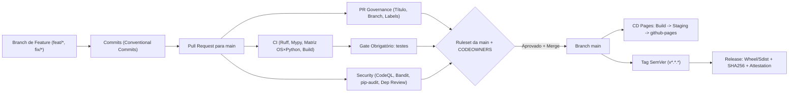

# GitWorflow — Implementação Completa de GitHub Workflow (TCC)

[](https://github.com/PEDR0PEDR0PEDR0/GitWorflow/actions/workflows/ci.yml)
[](https://github.com/PEDR0PEDR0PEDR0/GitWorflow/actions/workflows/security.yml)
[](https://github.com/PEDR0PEDR0PEDR0/GitWorflow/actions/workflows/cd-pages.yml)
[](https://github.com/PEDR0PEDR0PEDR0/GitWorflow/actions/workflows/release.yml)
[](LICENSE)
[](pyproject.toml)

Projeto de Trabalho de Conclusão de Curso (TCC) que demonstra, de ponta a ponta, uma **implementação completa de GitHub Workflow** baseada na documentação oficial do GitHub — integrando **GitHub Flow**, **GitHub Actions (CI/CD)**, **DevSecOps**, **Governança de Repositório**, **Reusable Workflows**, **Composite Actions**, **GitHub Environments**, **GitHub Pages** e **Releases com Build Provenance Attestation**.

---

## Visão Geral do Fluxo (GitHub Flow + CI/CD)



---

## Workflows Implementados

| Workflow | Arquivo | Gatilhos | Principais Recursos Demonstrados |
| :--- | :--- | :--- | :--- |
| **CI** | `.github/workflows/ci.yml` | `push`, `pull_request`, `workflow_dispatch` | Lint/format (`ruff`), tipagem (`mypy --strict`), validação YAML, matriz multi-SO/Python chamando Reusable Workflow, build/smoke test do wheel e job gate `testes` |
| **Reusable Checks** | `.github/workflows/reusable-python-checks.yml` | `workflow_call` | Inputs tipados, `outputs`, Composite Action local, `pytest` com cobertura ≥ 90%, artefatos e `$GITHUB_STEP_SUMMARY` |
| **PR Governance** | `.github/workflows/pr-governance.yml` | `pull_request` | Validação de Conventional Commits, padrão de branch, métrica de tamanho (`XS`–`XL`), proteção contra *script injection* e `actions/labeler@v5` |
| **Security** | `.github/workflows/security.yml` | `push`, `pull_request`, `schedule`, `workflow_dispatch` | GitHub CodeQL (`security-extended`), Bandit SAST, `pip-audit` e Dependency Review Action |
| **CD GitHub Pages** | `.github/workflows/cd-pages.yml` | `push (main)`, `workflow_dispatch` | Portal estático + relatório HTML de cobertura, pipeline multi-ambiente (`staging` → `github-pages`) e deploy com OIDC |
| **Release** | `.github/workflows/release.yml` | `push (tags v*.*.*)`, `workflow_dispatch` | Validação SemVer × `__version__`, build `wheel`/`sdist`, `SHA256SUMS.txt`, `actions/attest-build-provenance@v2` e GitHub Release com notas automáticas |
| **Maintenance** | `.github/workflows/maintenance.yml` | `schedule` (semanal), `workflow_dispatch` | Verificação periódica de saúde dos testes/workflows e `actions/stale@v9` |

### Componentes de Reuso e Governança

- **Composite Action:** `.github/actions/setup-python-env/action.yml` (encapsula `setup-python`, cache `pip` e instalação editável com extras).
- **Automação de Dependências:** `.github/dependabot.yml` (`pip` e `github-actions` agrupados semanalmente).
- **Governança & Comunidade:** `.github/CODEOWNERS`, `.github/PULL_REQUEST_TEMPLATE.md`, `.github/ISSUE_TEMPLATE/` (Issue Forms YAML), `.github/labeler.yml`, `.github/release.yml`, `.github/rulesets/main-protection.json`, `CONTRIBUTING.md`, `SECURITY.md`, `CODE_OF_CONDUCT.md`, `CHANGELOG.md` e `LICENSE`.

---

## Aplicação Base (`calculadora`)

A calculadora original evoluiu para um pacote Python tipado (`pyproject.toml` + `py.typed`), sem dependências de runtime, com interface de linha de comando (`calculadora`) e gerador de portal estático (`scripts/build_pages.py`):

### Instalação e Uso Local

```bash
python -m venv .venv
# Windows (PowerShell):
.\.venv\Scripts\Activate.ps1
# Linux / macOS:
source .venv/bin/activate

pip install -e ".[dev,build]"
```

### Exemplos da CLI

```bash
calculadora --version
calculadora somar 2 3
calculadora dividir 10 4
calculadora potencia 2 8
calculadora raiz 81
calculadora fatorial 5
calculadora estatistica 10 20 30 40
calculadora --json estatistica --amostral 10 20 30
```

### Validação Completa Local (espelho da CI)

```bash
ruff check .
ruff format --check .
mypy calculadora tests scripts
python scripts/validate_workflows.py
python -m pytest -v --cov=calculadora --cov-report=term-missing --cov-fail-under=90
bandit -r calculadora scripts -ll
python -m build && twine check dist/*
python scripts/build_pages.py
```

---

## Documentação Técnica do TCC

| Documento | Conteúdo |
| :--- | :--- |
| [Arquitetura dos Workflows](docs/arquitetura-workflows.md) | Explicação detalhada de cada recurso oficial do GitHub Actions/Flow, diagramas Mermaid e padrão do Gate Job `testes` |
| [Guia de Configuração no GitHub](docs/configuracao-github.md) | Passo a passo (Interface Web e `gh` CLI) para Rulesets, Environments, Pages, Security e Labels |
| [Roteiro de Demonstração do TCC](docs/cenarios-demonstracao-tcc.md) | 5 cenários práticos prontos para apresentação ao vivo para a banca avaliadora |
| [Guia de Contribuição](CONTRIBUTING.md) | Convenções de branch, Conventional Commits e fluxo de Pull Request |
| [Política de Segurança](SECURITY.md) | Camadas DevSecOps e processo de relato responsável de vulnerabilidades |

---

## Estrutura do Projeto

```text
.
├── .github/
│   ├── actions/setup-python-env/action.yml       # Composite Action local
│   ├── ISSUE_TEMPLATE/                           # Issue Forms YAML + config.yml
│   ├── rulesets/main-protection.json             # Especificação declarativa do Ruleset da main
│   ├── workflows/
│   │   ├── ci.yml                                # CI completo + Gate `testes`
│   │   ├── reusable-python-checks.yml            # Reusable Workflow (workflow_call)
│   │   ├── pr-governance.yml                     # Conventional Commits, branch e auto-label
│   │   ├── security.yml                          # CodeQL, Bandit, pip-audit e Dep Review
│   │   ├── cd-pages.yml                          # CD multi-ambiente para GitHub Pages
│   │   ├── release.yml                           # Release SemVer + Build Attestation
│   │   └── maintenance.yml                       # Saúde semanal + stale
│   ├── CODEOWNERS
│   ├── PULL_REQUEST_TEMPLATE.md
│   ├── dependabot.yml
│   ├── labeler.yml
│   └── release.yml
├── calculadora/                                  # Pacote Python tipado + CLI
│   ├── __init__.py
│   ├── __main__.py
│   ├── cli.py
│   ├── estatistica.py
│   ├── excecoes.py
│   ├── operacoes.py
│   └── py.typed
├── docs/                                         # Documentação técnica e roteiro do TCC
├── scripts/
│   ├── build_pages.py                            # Gerador do portal estático (GitHub Pages)
│   └── validate_workflows.py                     # Validador estrutural de .github/
├── tests/                                        # Suíte pytest (unit, cli, pages)
├── pyproject.toml
├── requirements.txt
├── CHANGELOG.md
├── CODE_OF_CONDUCT.md
├── CONTRIBUTING.md
├── LICENSE
├── README.md
└── SECURITY.md
```
