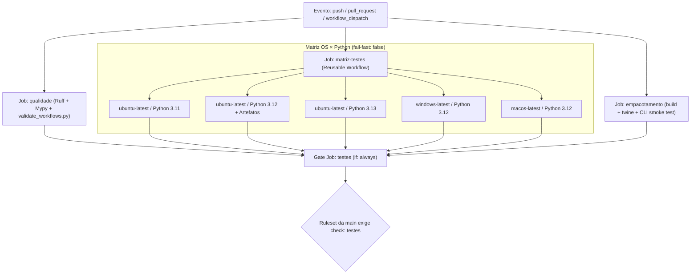
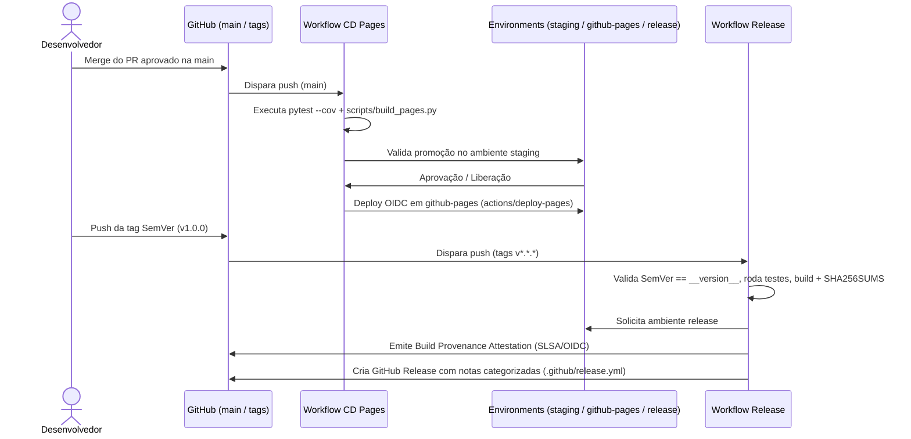

# Arquitetura dos Workflows (Referência Técnica do TCC)

Este documento mapeia os conceitos oficiais da documentação do GitHub (**GitHub Flow**, **GitHub Actions**, **Repository Rulesets**, **Environments** e **Supply Chain Security**) para os artefatos implementados neste repositório.

---

## 1. Os Dois Pilares do "GitHub Workflow"

Na engenharia de software moderna centrada no GitHub, o termo *GitHub Workflow* engloba dois pilares complementares:

1. **GitHub Flow (Processo de Colaboração e Versionamento):**
   - Branch principal (`main`) permanentemente estável e implantável.
   - Todo trabalho ocorre em branches curtas e descritivas (`feat/*`, `fix/*`, `ci/*`, `docs/*`).
   - Integração exclusiva via **Pull Requests** com revisão por `CODEOWNERS`, conversas resolvidas e checks obrigatórios garantidos por **Repository Rulesets**.
2. **GitHub Actions Workflows (Automação CI/CD e DevSecOps):**
   - Definições declarativas em YAML dentro de `.github/workflows/` disparadas por eventos do repositório (`push`, `pull_request`, `schedule`, `workflow_dispatch`, `workflow_call`).
   - Execução isolada em runners efêmeros (`ubuntu-latest`, `windows-latest`, `macos-latest`) com controle de concorrência, permissões granulares e rastreabilidade via artefatos e *Step Summaries*.

---

## 2. Arquitetura do Pipeline de CI e Padrão Gate Job (`testes`)

Quando um workflow usa `strategy.matrix`, o GitHub gera um check distinto para cada combinação da matriz (por exemplo, `Matriz de Testes / Testes (ubuntu-latest / Python 3.12)`). Se a matriz evoluir (adicionando Python `3.14` ou removendo `3.11`), regras de branch protection baseadas em nomes individuais da matriz quebram ou ficam defasadas.

A prática recomendada pela documentação oficial do GitHub é o **padrão Gate Job (Aggregator Job)**:

### Por que o Gate Job se chama `testes`?
O ruleset configurado anteriormente na branch `main` do repositório já exige o check `testes`. Mantendo o job agregador com exatamente esse nome (`name: testes`), garantimos **retrocompatibilidade imediata** com o ruleset enquanto ampliamos a proteção para exigir, simultaneamente, lint, formatação, tipagem, validação de workflows, testes em 3 sistemas operacionais, cobertura ≥ 90% e validação do pacote wheel/sdist.

---

## 3. Reutilização: Composite Action vs. Reusable Workflow

O projeto demonstra ambos os mecanismos oficiais de reuso do GitHub Actions e quando escolher cada um:

| Mecanismo | Implementação no Repositório | Granularidade | Quando Utilizar |
| :--- | :--- | :--- | :--- |
| **Composite Action** | `.github/actions/setup-python-env/action.yml` | **Steps** (executa dentro do mesmo runner/job) | Padronizar sequências repetidas de passos (ex.: setup Python + cache `pip` + instalação de extras) sem overhead de novo runner |
| **Reusable Workflow** | `.github/workflows/reusable-python-checks.yml` | **Jobs completos** (`on: workflow_call`) | Reutilizar pipelines completos parametrizados por SO, versão de runtime, `inputs`, `outputs`, permissões e upload de artefatos |

---

## 4. Entrega Contínua (CD) e Releases com Provenance Attestation

---

## 5. Controles de Segurança (DevSecOps)

Cada decisão de segurança nos workflows segue o guia oficial *Security Hardening for GitHub Actions*:

1. **Privilégio Mínimo (`permissions`):** todos os workflows iniciam com `permissions: contents: read` no topo; permissões de escrita (`security-events: write`, `pages: write`, `pull-requests: write`, `attestations: write`) existem apenas no job estritamente necessário.
2. **Prevenção de Script Injection:** campos controlados pelo usuário (como `github.event.pull_request.title` em `pr-governance.yml` e `inputs.tag` em `release.yml`) nunca são interpolados diretamente no comando shell; são passados via variáveis de ambiente (`env:`).
3. **Proteção para PRs de Forks:** o job `auto-label` usa condição explícita `github.event.pull_request.head.repo.full_name == github.repository`, evitando o uso perigoso de `pull_request_target` com checkout de código externo.
4. **Análise Contínua e Cadeia de Suprimentos:**
   - **SAST:** CodeQL (`security-extended`) + Bandit.
   - **Dependências:** `pip-audit`, `actions/dependency-review-action` e Dependabot para `pip` e `github-actions`.
   - **Integridade de Artefatos:** `SHA256SUMS.txt` + `actions/attest-build-provenance@v2` (assinatura criptográfica OIDC vinculando o artefato `.whl`/`.tar.gz` ao commit e workflow exatos que o geraram).
5. **Proteção contra Execuções Infinitas e Concorrência:** todo job define `timeout-minutes` explícito, e todos os workflows definem grupos de `concurrency` (cancelando builds obsoletas em PRs, mas nunca interrompendo deploys em `pages` ou `release`).

---

## 6. Mapeamento para a Documentação Oficial do GitHub

| Conceito Oficial do GitHub | Arquivo(s) no Repositório |
| :--- | :--- |
| Workflow syntax, contexts & expressions | `.github/workflows/*.yml` |
| Matrix strategies & `fail-fast` | `.github/workflows/ci.yml` |
| Caching dependencies (`setup-python`) | `.github/actions/setup-python-env/action.yml` |
| Creating a composite action | `.github/actions/setup-python-env/action.yml` |
| Reusing workflows (`workflow_call`) | `.github/workflows/reusable-python-checks.yml` |
| Concurrency & timeouts | Todos os arquivos em `.github/workflows/` |
| Job Summaries (`$GITHUB_STEP_SUMMARY`) | `ci.yml`, `reusable-python-checks.yml`, `pr-governance.yml`, `cd-pages.yml`, `maintenance.yml` |
| Environments & Deployment protection | `.github/workflows/cd-pages.yml`, `.github/workflows/release.yml` |
| GitHub Pages with Actions | `.github/workflows/cd-pages.yml`, `scripts/build_pages.py` |
| Artifact Attestations (SLSA) | `.github/workflows/release.yml` |
| CodeQL & Dependency Review | `.github/workflows/security.yml` |
| Dependabot version updates | `.github/dependabot.yml` |
| Repository Rulesets & CODEOWNERS | `.github/rulesets/main-protection.json`, `.github/CODEOWNERS` |
| Issue Forms, PR Templates & Release Notes | `.github/ISSUE_TEMPLATE/*`, `.github/PULL_REQUEST_TEMPLATE.md`, `.github/release.yml` |
